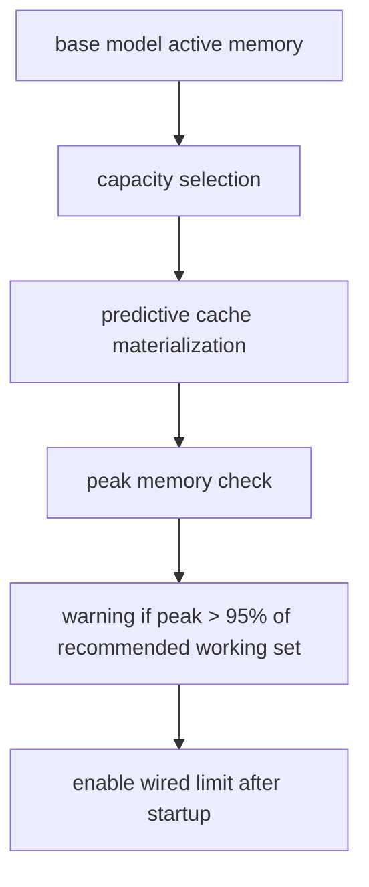
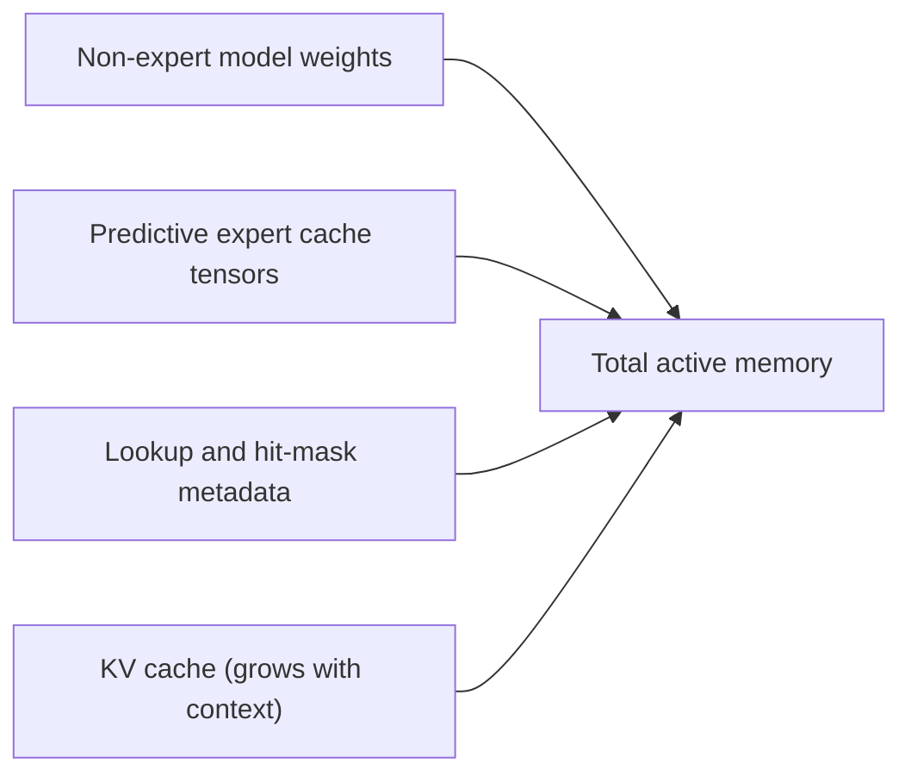

# Memory and Capacity

[Back to Architecture Overview](README.md)

This page covers capacity math, working-set targeting, and runtime memory behavior.

## Capacity Selection

`select_capacity(...)` targets 71% of Metal's recommended working-set size:

```text
target_gb = 0.71 * max_recommended_working_set_size_gb
slot_gb = num_moe_layers * expert_slot_mb / 1024
capacity = floor((target_gb - base_memory_gb) / slot_gb)
```

`expert_slot_mb` includes `weight + scales + biases`.

Faithful adaptive growth uses a stricter 60% target to preserve transient expert
loading and KV headroom on 16 GB systems. It estimates bytes for one full
expert slot from loaded tensors, includes unfilled reserved slots, then grows
all active MoE-layer capacities uniformly by at most eight slots per token.
Projected memory includes MLX allocator cache, avoiding repeated jumps based
only on active tensors. Faithful startup caps allocator retention at 256 MB so
evicted expert batches do not remain wired.

Faithful generation defaults to 16-token prefill chunks. Large prompt chunks
can route more unique experts than cache capacity and require all of them
transiently for exact output; bounded chunks prevent that Metal-memory spike.

## Memory Control Flow



## Runtime Memory Buckets



Example at capacity around `208` on a `32 GB` machine:

- non-expert base weights
- predictive expert cache (`capacity x moe_layers`)
- lookup/hit-mask metadata
- KV cache growth during generation

## Wired Memory


Wiring is intentionally applied after expert loading/refinement.

## Loading Strategy Notes

- Fresh `mx.load()` calls in hot paths avoid retaining lazy refs that can keep large source tensors materialized.
- `SafetensorsMap` enables mmap-based expert slicing to avoid loading full stacked tensors when only selected experts are needed.
